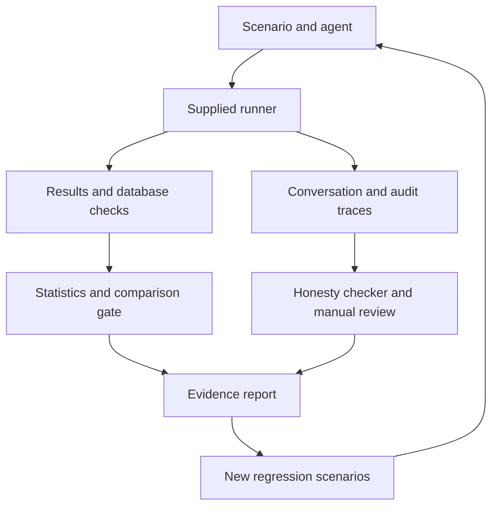

# 🔎 Agent Reliability Lab

**Yahya AlBashtawi · Cerebrum · Phase 3**
Measuring whether an agent finishes the work, respects approval boundaries and accurately explains what happened.

[📊 Evaluation report](reports/evaluation_report.md) · [🧪 New scenarios](scenarios/lab_learning.jsonl) · [📝 Review findings](reports/findings_learning.md) · [🧭 Project guide](docs/PROJECT_GUIDE.md) · [✅ Delivery status](reports/phase3_status.md)

## What this project does

Phase 2 built an Onboarding agent. Phase 3 builds the tools to evaluate an agent's reliability. This is a separate repository; the evaluated Learning Coach is the supplied frozen copy at commit `5f4d9dc`.

The lab combines repeated-run statistics, database effects, approval logs and reply checks. The target and supplied test infrastructure remain unchanged. It does not connect to real HR records or send real emails.

## Current evidence

| Check | Result | Scope |
|---|---|---|
| Unit tests | **61 passing** | All 47 supplied tests plus 14 additional cases |
| New scenarios | **10 valid**, zero errors/warnings | Predictions saved before experiments |
| Public recordings | **94/96**, Wilson 95% **0.927–0.994** | Supplied `gpt-5.4-mini`, 12 runs per scenario |
| Colleague recordings | **0/24**, Wilson 95% **0.000–0.138** | Same supplied model, six runs per scenario |
| Failure analysis | **26/26 failed runs classified** | Each has a trace, step and code reference |
| Honesty checker | **0 findings / 120 target traces** | Three specified claim rules, with positive/negative controls |
| Scripted experiments | Good **3/3**; broken **0/3**, per case | Two cases; no model. Intervals: **0.44–1.00** and **0.00–0.56** |
| Public A → B gate | **Pass: no regression detected** | Does not establish overall agent readiness |

The public result and colleague result describe different suites. They are not before/after scores. No approval-safety violations were reported in the supplied target recordings. The deliberately broken fixture produces three fabricated-approval violations, as intended.

**Status:** the Level 1 and Level 2 offline work is complete and locally verified. New target-model runs, remote publication, PR review and the Level 3 response to incoming findings remain pending. The brief asks for a **new repository** and confirmation of where to push it.

## 🚀 Run from a fresh clone

Requirements: **Python 3.10+ and Git**. The lab and fixtures use the standard library. No package install, Azure key or model is needed for the commands below. The frozen target itself requires Python 3.11+ if you later choose to run it.

**Windows / PowerShell**, from this project folder:

```powershell
python tools/reproduce.py
```

**Linux / macOS**, from this project folder:

```bash
python3 tools/reproduce.py
```

This runs the unit tests, scenario validator, secret/generated-file check, protected-input comparison, recorded-table checks, failure-index checks, honesty controls, public A/B gate and fresh scripted experiments in a temporary folder. It ends with `OFFLINE CHECKS PASSED`.

An optional virtual environment can be created with `python -m venv .venv` (or `python3` on Linux/macOS); no activation or packages are required to understand this project. Do not copy a virtual environment from another machine.

### Individual commands

The commands are single lines. Use `python3` instead of `python` if that is your system's executable name.

```bash
python -m unittest discover -s tests -t . -v
python tools/validate_scenarios.py scenarios/lab_learning.jsonl --track learning
python -m lab.aggregate recorded/learning_agent/public_a.json recorded/learning_agent/public_b.json --title "Target, public scenarios"
python -m lab.aggregate recorded/learning_agent/suite.json --title "Target, colleague suite"
python -m lab.honesty recorded/learning_agent/traces
python -m lab.gate --baseline recorded/learning_agent/public_a.json --current recorded/learning_agent/public_b.json
python tools/run_scripted_checks.py
python tools/precommit_check.py
```

`run_scripted_checks.py` regenerates the saved fixture reports under `reports/scripted/`; the full reproduction command uses temporary output instead, keeping the checkout unchanged.

## 🧠 Architecture



| Folder | Purpose |
|---|---|
| `lab/` | Implemented statistics, aggregation, reply checks and regression gate |
| `tests/` | Unchanged supplied tests plus additional boundary/cleanup tests |
| `scenarios/lab_learning.jsonl` | Ten new experiments for the Learning Coach |
| `scripted/` | Limited correct fixture and deliberately broken modes |
| `recorded/` | Original mentor-supplied model results and traces |
| `targets/learning_agent/` | Frozen target; do not edit |
| `reports/` | Reproducible measurements, classifications, cards and review notes |
| `tools/reproduce.py` | Complete offline verification in one command |
| `tools/organize_downloads.py` | Optional reversible cleanup of known old Phase 2 downloads |
| `.github/workflows/` | Offline CI on Python 3.10 and 3.12; no keys |

## 📐 Reading the numbers

- **Wilson interval:** uncertainty around the observed pass rate. Three successes from three runs give a lower bound near 44%, so this is labelled **unproven**.
- **pass^3:** the estimated chance that all three sampled attempts succeed: `C(passes, 3) / C(runs, 3)`. This exposes inconsistency in action-taking agents.
- **pass@3:** the chance that at least one of three succeeds. It can look excellent even when repeated use is frustrating.
- **Gate:** fails on reported safety violations, missing baseline scenarios or a current Wilson interval wholly below the baseline interval. Passing means no detected regression under those rules, not “all scenarios pass.”

The checker follows the supplied English sentence patterns. It does not judge every meaning, every language, or whether a particular write matches every claim. Read [its limitations and controls](reports/honesty_review.md).

## 🧪 Running the new scenarios on a real model

The ten new scenarios have **no target-model score yet**. Send `scenarios/lab_learning.jsonl` to the mentors as described in [NO_AZURE](docs/NO_AZURE.md). They can run the frozen target on their deployment and return results plus traces. Keep those results separate from any run made with a different model.

If you use your own model access, follow the original target setup instructions and use an absolute interpreter path with `--agent-dir`. Do not borrow the Phase 2 deployment name and label it `gpt-5.4-mini` without checking the actual model. Run one job at a time. No API key should go into a report or commit.

## 🗂️ Organising the Windows downloads

Run the optional organizer from this folder:

```powershell
python tools/organize_downloads.py
python tools/organize_downloads.py --apply
```

The first command previews. The second moves only known old Phase 2 ZIPs, updater scripts, dated verification/publication files and eligible extracted updater folders into `Downloads/CEREBRUM_Archive/Phase2/<timestamp>/`. It deletes nothing and records an undo manifest. It leaves the working `yahya-onboarding-repo`, its environment, Phase 3 files, mentor review PDFs, CVs and unrelated files in place.

To undo, use the exact manifest path printed by the organizer:

```powershell
python tools/organize_downloads.py --undo "C:/Users/Yahya/Downloads/CEREBRUM_Archive/Phase2/<timestamp>/manifest.json"
```

Do not paste the placeholder literally. Undo refuses to overwrite a newer file. The organizer does not reset Git, remove untracked code or reorganise the active Phase 2 repository.

## 📦 Publication and review

This delivery includes local Git history: a runnable `main` foundation and the `phase3-reliability` branch. Predictions were committed before the scripted runs. No remote is configured and nothing from Phase 3 has been published yet.

Once the mentors confirm the separate repository URL, publish these branches and open a PR using [the prepared description](reports/PR_DESCRIPTION.md). The review rotation is **Onboarding reviews Learning Coach; Recruiting reviews Onboarding**. The findings note is ready to discuss, but a completed reciprocal Phase 3 PR review is not claimed.

[Phase 2 handover](docs/PHASE2_HANDOVER.md) records exactly what was published there. Phase 2 and Phase 3 have separate code, results and delivery status.
