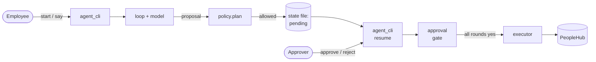
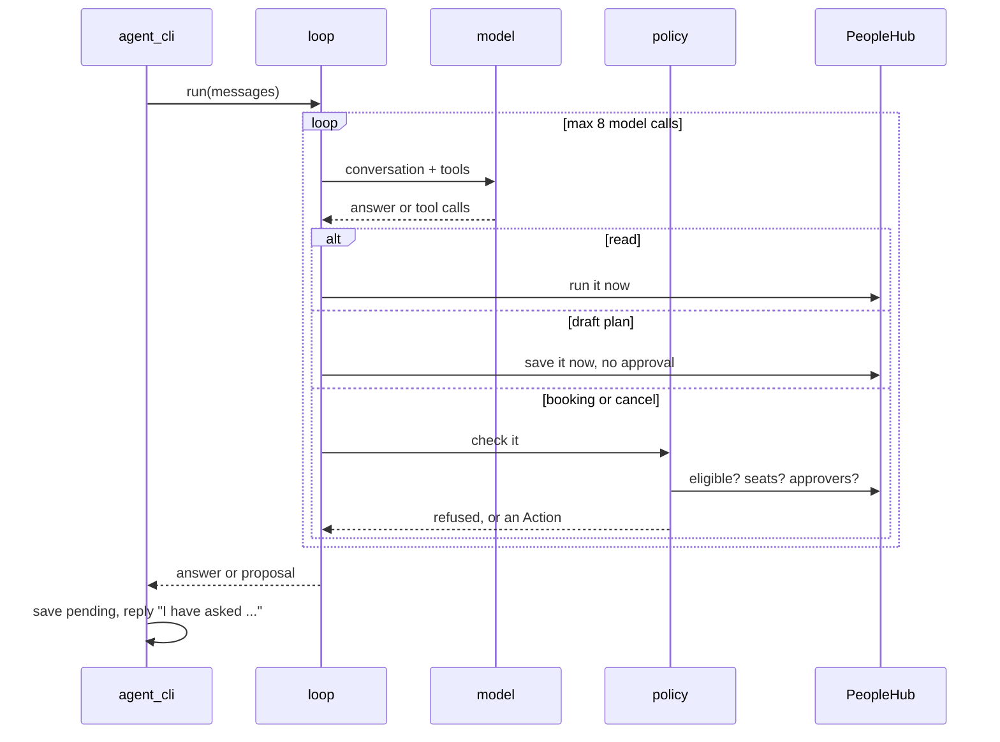
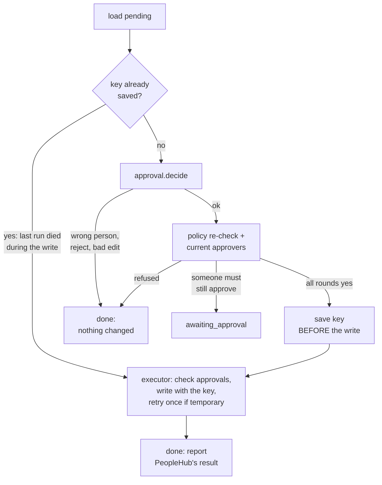

# Learning Coach Agent (Agent Bank ID 33)

An enrolment assistant for the fictional Al Dana Group. An employee asks for a course in plain words; the agent looks
things up in PeopleHub, checks the rules, and proposes the booking. **Nothing is written until the right humans approve
it**, and the approver's id comes only from the approval command, never from the model.

The brief is `02_Phase2_Brief_Learning_Coach_Agent.pdf`, the API is `docs/LRN_API.md`, and the command-line contract
is `harness/README.md`.

## Run it from a fresh clone

Python 3.11 or newer.

```
python3 -m venv .venv && source .venv/bin/activate
pip install -r requirements.txt
cp .env.example .env          # fill in the three Azure OpenAI values (ask the mentors); never commit .env
python3 tools/check_model.py  # the model answers and can call a tool
python3 -m unittest discover -s tests -v
python3 harness/run_scenarios.py --track learning --agent "python3 agent_cli.py" --scenarios scenarios/learning_public.jsonl -v
python3 scenarios/make_my_scenarios.py
python3 harness/run_scenarios.py --track learning --agent "python3 agent_cli.py" --scenarios scenarios/my_scenarios.jsonl -v
```

Add `--repeat 3` to check that a scenario passes every time, and `--keep` to keep each run's database and state.

## How it works

```
agent_cli.py        start / say / resume -> exactly one JSON object on stdout
agent/loop.py       model <-> tools loop; the model only proposes
agent/tools.py      reads (run freely), low-risk writes (run, no approval), proposals (never run here)
agent/policy.py     checks a proposal BEFORE any human is asked; approvers come from check_enrolment
agent/approval.py   the approval gate: a pure state machine (approve / reject / modify, one or two rounds)
agent/executor.py   the only place an enrolment is booked or cancelled: idempotency key, one retry
agent/state.py      one JSON file per thread in $AGENT_STATE_DIR, saved atomically
```

A request flows like this. `start` runs the loop. Read tools run straight away. A proposal (`request_enrolment`,
`cancel_enrolment`) is checked by `policy.plan`. If PeopleHub would refuse it, the model is told why and explains it to
the user. If it would be allowed, the agent saves the pending request and answers `awaiting_approval`. `resume`
applies the human's decision in `approval.decide`, checks the action again (and takes the current approvers, keeping
the approvals that still fit), and only when every round is approved does `executor.execute` call PeopleHub, with
`approved_by` taken from the `--by` values. The idempotency key is saved before the write, so if the process dies
during the write, the next `resume` sends the same write with the same key and reports what really happened.

### The full flow

`start` and `say` are the employee's turn and use the model. `resume` is the approver's turn and never calls the model.
Every command is a new process; the state file is the only memory between them.

**1. The big picture.** Two turns, two processes, one file between them.



**2. The employee's turn** (`start` / `say`, uses the model).



**3. The approver's turn** (`resume`, no model).



## Why it is built this way

**Safety: what the model can and cannot do**

| Decision | Why |
|---|---|
| The model only *proposes*; `request_enrolment` and `cancel_enrolment` are names in `tools.PROPOSALS` with no function behind them | The loop has nothing to run, so even a bug in the loop can't book. The only path to a write is `resume` → approval gate → executor |
| `actor`, `approved_by` and `idempotency_key` are stripped from the model's arguments (`tools.RESERVED`) | Who we act for, who approved and the request key are facts the system owns. The model can't pretend to be someone else or approve its own request |
| Messages and tool results are treated as data, never as instructions | "My manager already approved" is text, not an approval. The gate is code, so no sentence can open it |
| The prompt is not a safety layer | The prompt asks the model to behave; `policy.py`, `approval.py` and `executor.py` make misbehaviour harmless. Deleting the prompt makes the agent worse, not unsafe |

**Approvals**

| Decision | Why |
|---|---|
| Every proposal is checked by `policy.plan` *before* anyone is asked | Nobody should be asked to approve something PeopleHub will refuse. It keeps approvals meaningful |
| Approvers come from PeopleHub's `check_enrolment`, never from the code | One source of truth. It handles "the manager is the HR head" and changes in the org chart |
| Approvals happen in rounds: the line manager first, then the HR head | The HR head is never asked about something the manager might still reject |
| `approval.decide` is a pure function (it deep-copies, no disk, no model) | Every path can be tested in milliseconds, and a crash in the middle leaves the saved request unchanged |
| The *who* is checked before the decision word | Otherwise anyone could close someone else's request with a reject |
| An approver may only change `session_id` (an allowlist), and the change is checked again | A changed request is a new request, and it may not be allowed |
| Every `resume` re-checks the request and takes the *current* approvers, keeping the approvals that still fit | Time passes while a request waits: a seat goes, a manager changes. An approval checked at open time can be stale at write time |
| `executor.fully_approved` checks the approvals again, right before the write | Defence in depth: the gate checks, the executor checks, PeopleHub checks. A future bug in `resume` still can't write |

**Writing safely: idempotency, retry, recovery**

| Decision | Why |
|---|---|
| Every write carries an idempotency key | PeopleHub returns the first result for a key it has seen, so the same action sent twice books once |
| The key is a hash of thread, tool, arguments and a count of past writes, not a random id | The same action always rebuilds the same key, even in a new process. The count makes "book, cancel, book again" three different actions |
| The key is saved in the state file *before* the write | If the process dies during the write, the key the write used is on disk, and the next `resume` can resend exactly that write |
| A request whose key is saved is finished, never decided again | Recovery doesn't need to know whether the write happened: same key + same arguments, and PeopleHub returns the stored booking (`duplicate: true`) or books it now. Failed writes are not stored, so they really run again |
| One retry, only for errors PeopleHub marks as temporary, with the same key | A retry with the same key can't book twice. A real refusal (full session, wrong approver) needs an explanation, not another try |
| Draft learning plans run at once, with a key built from the plan itself | A draft books nothing, so asking a manager would be noise. The key means the same plan in the same thread is saved once |
| `executor.py` is the only file that calls the booking and cancel functions | One place to read, test and trust. Search for `request_enrolment(` and you find one call |

**The loop and the model**

| Decision | Why |
|---|---|
| `MAX_MODEL_CALLS = 8` per turn | A confused model could otherwise loop forever, and every call costs time and money. 8 is enough for the longest real path (find, check, sessions, profile, propose) with room for one correction |
| At the limit, the answer lists what was really saved | The stop message is a claim. If a draft plan was saved, "nothing changed" would be false |
| Every tool call gets exactly one reply, even a second proposal (`ONE_AT_A_TIME`) | The model API rejects a history with an unanswered call, which would break the next `say` |
| One proposal at a time per thread | One pending request keeps `resume` simple: there is never a question of which request a decision is for |
| The system prompt is rebuilt on every call, not saved | It is code, not conversation. The saved history stays what was said, and a prompt fix applies to old threads too |
| The model is passed in as a plain function (`chat`) | Tests use a fake model: no network, no key, the same result every time |
| `temperature=0` | The same input gives (nearly) the same output, so scenario runs are repeatable |

**State and honesty**

| Decision | Why |
|---|---|
| One JSON file per thread, written to a temp file and renamed (`os.replace`) | Every command is a new process, so the file is the only memory. The rename is atomic: a crash leaves the old file or the new one, never half of each |
| A thread id must match a strict pattern | It becomes a file name, so `../` can't escape the state folder |
| Messages that make claims ("I have asked …", "Done: …") are written by code from real results | The code knows what happened; the model might paraphrase it wrongly or claim a booking that didn't happen |
| `finish` saves the state, then prints | The user is never told something the state file doesn't record |
| A crash still prints one valid JSON object | The harness always gets an answer it can parse |
| `TypedDict` for the data between files | It documents the shape for readers and the editor, but stays a plain dict, so saving to JSON needs no conversion |
| Python 3.11+ | `typing.NotRequired` is new in 3.11 |

Rejected alternatives are in `notes/decision_log.md`; results are in `notes/results_note.md`.

Run `python3 tools/precommit_check.py` before every commit.
